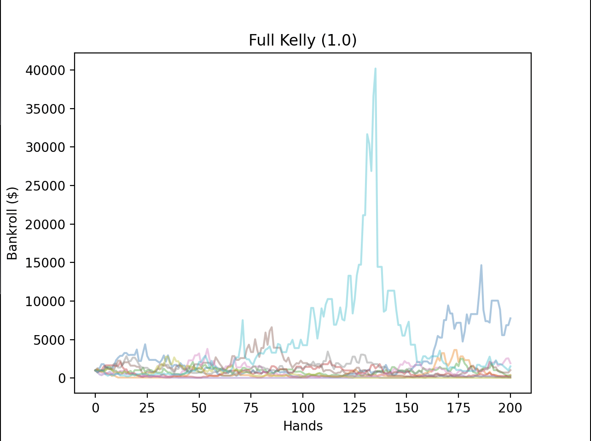
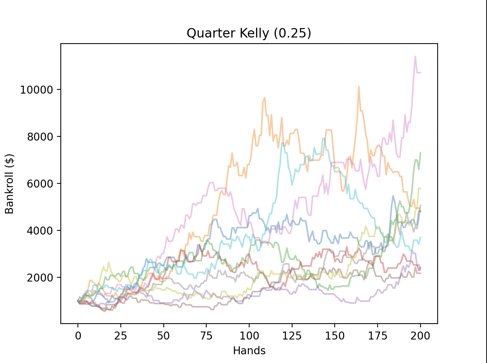

# Bayesian Poker & Quantitative Risk Engine

An end-to-end quantitative decision engine for No-Limit Texas Hold'em built from scratch in Python and NumPy. The system combines deterministic combinatorics, Monte Carlo equity estimation, Bayesian belief updating, unsupervised K-Means opponent profiling, and Fractional Kelly position sizing under institutional portfolio risk constraints.

---

## System Architecture

The codebase is organized into five modular stages:

1. **Deterministic 7-Card Hand Evaluator (`src/engine.py`)**
   - Integer card encoding ($0\text{–}51$) with modulo rank (`card % 13`) and integer-division suit (`card // 13`) arithmetic.
   - Evaluates all $\binom{7}{5} = 21$ five-card combinations with full intra-tier kicker tie-breaking and Ace-low Wheel straight detection.

2. **Monte Carlo Equity Engine (`src/mc_simulation.py`)**
   - Estimates Hero's win equity against unknown holdings via random board runouts without replacement.
   - Computes 95% Central Limit Theorem (CLT) confidence intervals ($\hat{p} \pm 1.96 \sqrt{\frac{\hat{p}(1-\hat{p})}{n}}$) and Law of Large Numbers convergence trajectories.

3. **Bayesian Range Updater (`src/bayesian_update.py`)**
   - Exploits pre-flop suit symmetry to collapse all 1,326 starting hands into 169 canonical classes weighted by physical combination counts (6 pairs, 4 suited, 12 offsuit), partitioned into 10 equity deciles.
   - Models opponent betting propensity via an econometrically calibrated logit likelihood $P(\text{Bet} \mid S) = \frac{1}{1 + e^{-\beta(S - \alpha)}}$ and updates range beliefs via Bayes' Theorem.

4. **Unsupervised Opponent Profiler (`src/profiler.py`)**
   - Implements K-Means clustering from scratch in NumPy over standardized behavioral metrics (`VPIP`, `PFR`, `Aggression Factor`).
   - Resolves cluster label-switching by sorting centroids monotonically on VPIP, dynamically mapping opponents to behavioral regimes (**Nit**, **TAG**, **Maniac**) and their corresponding Bayesian betting threshold $\alpha$.

5. **Capital Growth & Risk Engine (`src/risk_management.py`)**
   - Filters positive Expected Value ($\text{EV} > 0$) opportunities and sizes wagers using the Fractional Kelly Criterion ($f^* = \frac{bp - q}{b}$).
   - Evaluates multi-career bankroll trajectories using **Sharpe Ratio**, **Maximum Drawdown (MDD)**, and **95% Conditional Value at Risk ($\text{CVaR}_{0.95}$)**.

---

## Empirical Backtest: Full Kelly vs. Quarter-Kelly

Simulated across independent 200-hand careers starting with a $1,000 bankroll against mixed opponent archetypes (**Nit**, **TAG**, **Maniac**), accounting for Monte Carlo equity estimation noise:

| Position Sizing Strategy | Per-Hand Sharpe | 200-Hand Session Sharpe | Avg. Max Drawdown (MDD) | Tail Risk ($\text{CVaR}_{0.95}$) |
| :--- | :---: | :---: | :---: | :---: |
| **Full Kelly ($f^* = 1.00$)** | `0.103` | `1.46` | `96.4%` | `-$965.68` |
| **Quarter Kelly ($f^* = 0.25$)** | **`0.137`** | **`1.94`** | **`50.8%`** | **`+$1,178.06`** |

### Bankroll Trajectories

| Full Kelly ($f^* = 1.0$) | Quarter Kelly ($f^* = 0.25$) |
| :---: | :---: |
|  |  |

**Key Takeaway:** Because Monte Carlo equity estimates contain finite-sample estimation variance, Full Kelly systematically over-bets perceived edges—leading to severe peak-to-trough drawdowns (`96.4%`) and near-total ruin in worst-case scenarios. Scaling down to **Quarter-Kelly** cuts drawdown nearly in half (`50.8%`), increases risk-adjusted return (`0.137` per-hand Sharpe), and preserves positive tail profitability (`+$1,178.06` $\text{CVaR}_{0.95}$).

---
## Connections to Quantitative Finance

Each component of this engine maps directly onto an institutional quantitative trading and portfolio management problem:

| Poker Engine Module | Quantitative Finance & Econometrics Parallel |
| :--- | :--- |
| **Monte Carlo Equity Engine (`src/mc_simulation.py`)** | **Derivative Pricing under Uncertainty:** Estimates fair terminal payoff $\mathbb{E}[\mathbb{I}(\text{Win})]$ across unseen state paths via Monte Carlo integration, bounded by Central Limit Theorem standard errors. |
| **Bayesian Range Updater (`src/bayesian_update.py`)** | **Order-Flow Toxicity & Discrete Choice Econometrics:** Models actions via McFadden's random utility logit likelihood and applies Bayes' Theorem to infer hidden counterparty information from trade/bet sizing. |
| **Unsupervised Opponent Profiler (`src/profiler.py`)** | **Market Regime & Counterparty Classification:** Segments counterparties into behavioral regimes (*Nit*, *TAG*, *Maniac*) via standardized K-Means clustering—analogous to distinguishing informed institutional flow from retail noise flow. |
| **Fractional Kelly & Risk Engine (`src/risk_management.py`)** | **Optimal Capital Allocation & Tail-Risk Control:** Sizes positions via Fractional Kelly ($0.25 f^*$) to mitigate parameter estimation error, evaluated via Sharpe Ratio, Maximum Drawdown (MDD), and 95% Conditional Value at Risk ($\text{CVaR}_{0.95}$). |

---

## Modeling Assumptions & Limitations

To keep the decision loop computationally tractable and focused on probabilistic inference and capital allocation, the current engine makes two structural simplifications:

1. **Terminal Showdown Valuation (No Fold Equity):** Decisions are evaluated using all-in showdown equity across a full 5-card board runout, treating each hand like a European-style terminal payoff contract rather than accounting for immediate fold equity ($\text{EV} = P(\text{Fold}) \cdot \text{Pot} + (1 - P(\text{Fold})) \cdot \text{Showdown EV}$).
2. **Single-Node Action Abstraction:** Future betting streets (flop, turn, river) are compressed into a single decision step rather than solved as a multi-street sequential game tree (such as Counterfactual Regret Minimization / CFR).

**Future Extensions:** Incorporating multi-street sequential updates across post-flop textures and modeling opponent fold-to-raise elasticities would generalize the agent from a static showdown-equity pricer into a full dynamic subgame solver.

## Repository Structure

```text
bayesian-poker-engine/
├── assets/
│   ├── full_Kelly.png
│   ├── quarter_Kelly.png
│   └── risk_metrics.png
├── src/
│   ├── __init__.py
│   ├── engine.py
│   ├── mc_simulation.py
│   ├── bayesian_update.py
│   ├── profiler.py
│   └── risk_management.py
├── tests/
│   ├── test_engine.py
│   ├── test_mc_simulation.py
│   ├── test_bayesian_update.py
│   ├── test_profiler.py
│   └── test_risk_management.py
├── README.md
├── requirements.txt
└── pytest.ini
